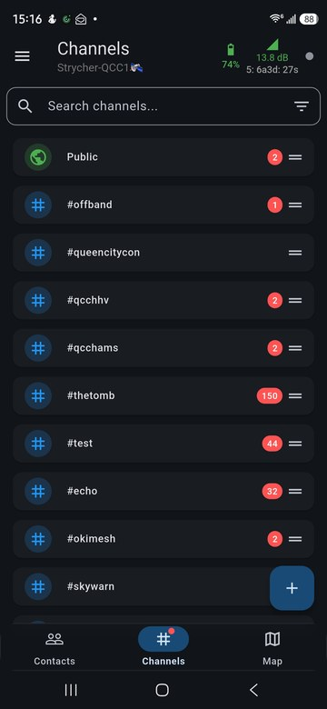
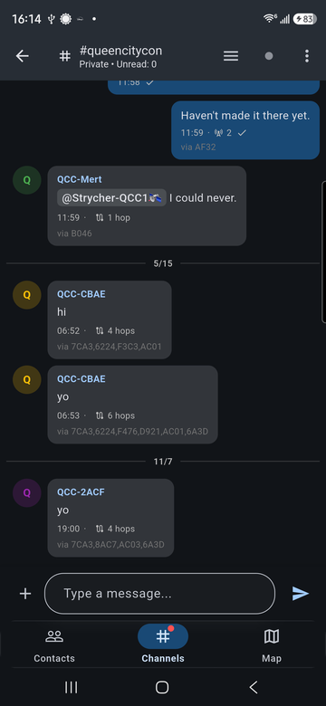
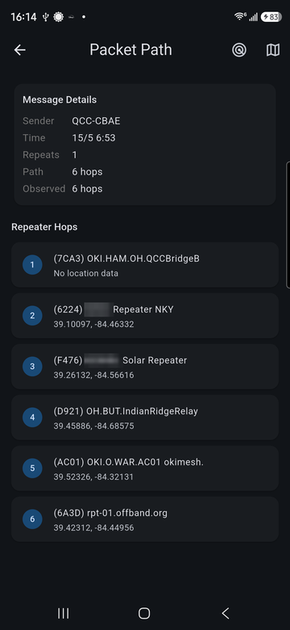
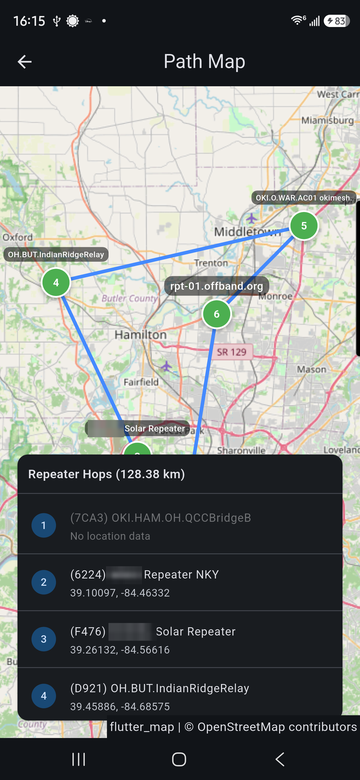
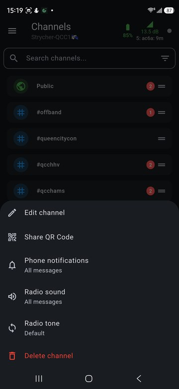
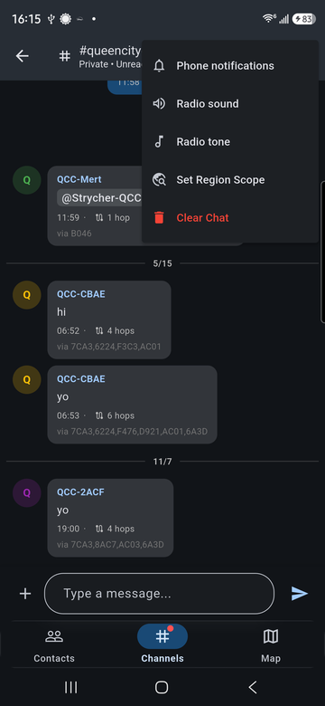

# Use channels

A channel is a group conversation. Everyone whose radio holds the same channel
key can read it. The **Channels** tab lists the channels stored on your radio,
with a red badge for unread messages.

## Kinds of channel

| Kind | Who can read it |
|---|---|
| **Public** | Every MeshCore radio. The app won't delete it, and Offband firmware keeps it in the first slot. |
| **Hashtag** (`#name`) | Anyone who joins the same name. The key is made from the name, so nothing secret is shared. |
| **Private** | Only people you give the secret key to, by typing it in or by sharing a QR code. |

## Add a channel

Tap **+** at the bottom right, then choose to create a private channel, join a
private channel by its key, join the Public channel, or join a hashtag channel by
name. Your radio has a fixed number of channel slots.

## Read and send

Tap a channel to open it. With message tracing on (**Settings > App Settings >
Enable Message Tracing**), each message also shows its time, how many hops it took
and the repeaters it came through.

Type `@` to mention someone; the app suggests recent senders and contacts. Tap a
message's hop count to see its full route, hop by hop, and the same route on a map.

## Channel actions

Long-press a channel (right-click on desktop) to open its actions.

- **Edit channel:** rename it, or change a private channel's key. Renaming a
  hashtag channel changes its key, because the key comes from the name. Whenever
  the key changes, the app asks whether to **keep** the message history (it moves
  to the new key) or **delete** it.
- **Share QR Code:** show a code another person can scan to join.
- **Phone notifications, Radio sound, Radio tone:** see
  [Notifications, sounds and radio tones](notifications-and-tones.md).
- **Delete channel:** removes it from the radio and deletes its message history.

Drag the handle on the right of a channel to change the order of the list.

## In a channel

The menu at the top right of an open channel has the notification, sound and tone
settings, **Set Region Scope** and **Clear Chat**.

**Set Region Scope** limits how far your messages in that channel travel: only
repeaters that allow the chosen region pass them on. It needs repeaters in your
area that have regions set up.
