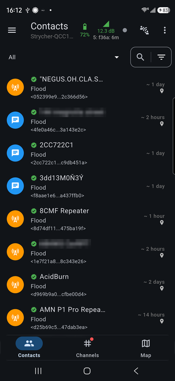
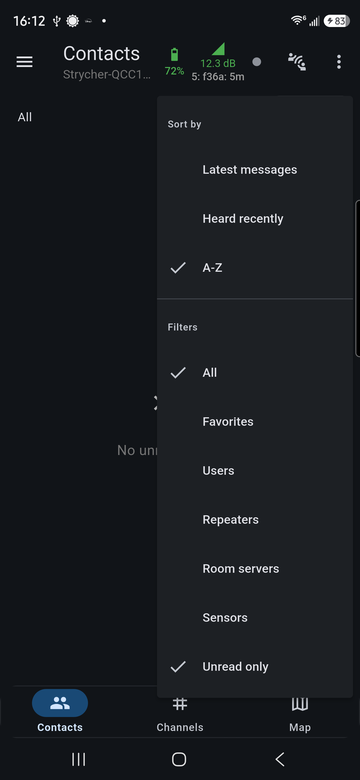
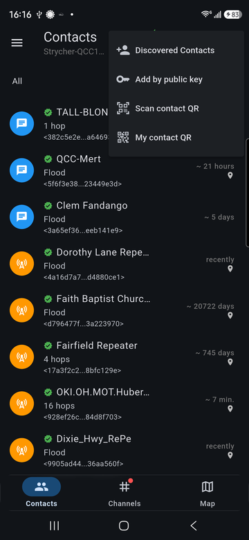
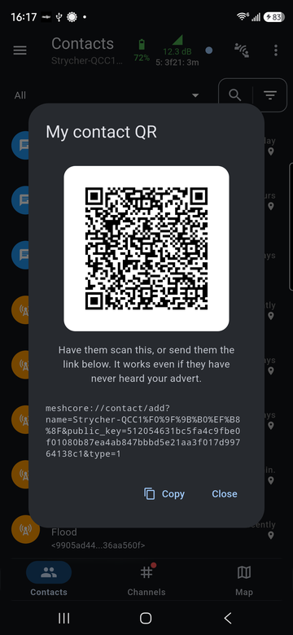
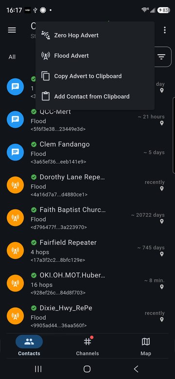
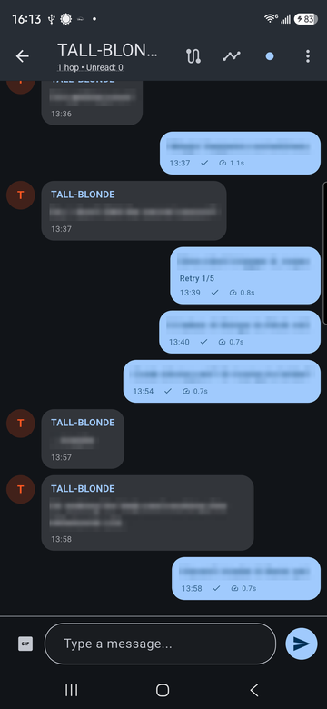
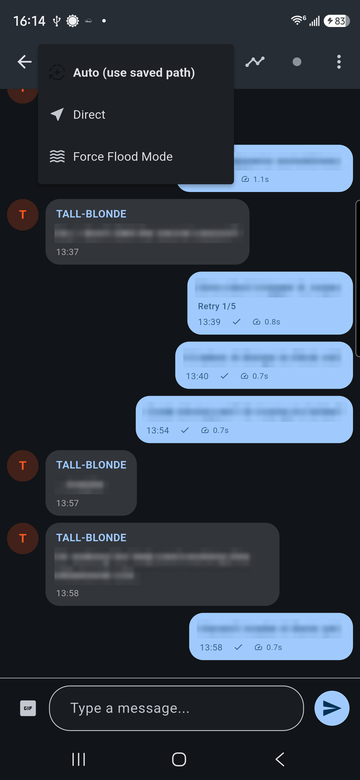
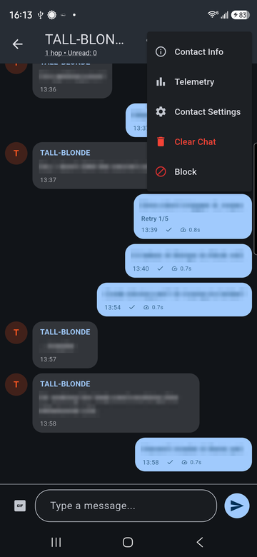
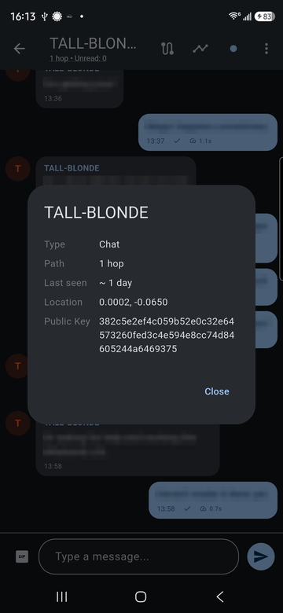
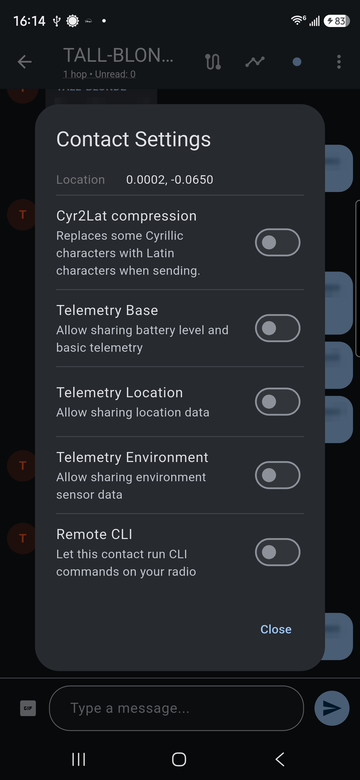

# Message contacts directly

The **Contacts** tab lists the nodes your radio knows: people (chat nodes),
repeaters, room servers and sensors. Each row shows the route to it (Flood or a
hop count), part of its public key and when it was last heard.

Use the filter button at the top right to sort by latest message, last heard or
name, and to show only favorites, one kind of node, or contacts with unread
messages.

## Add a contact

Nodes are added when your radio hears their advert, if automatic adding is on
for that kind of node (**Settings > Contacts**). Nodes heard but not added are in
the menu at the top right under **Discovered Contacts**.

The same menu can add a contact by public key or by scanning their QR code, and
shows **My contact QR** for others to scan. The QR's link works even if the other
person has never heard your advert.

## Let others find you

The broadcast button next to the menu sends your advert so other radios can add
you:

- **Zero Hop Advert** reaches only radios that hear you directly.
- **Flood Advert** is repeated across the mesh.

The same menu can copy your advert to the clipboard, or add a contact from an
advert someone else copied.

## Send a direct message

Tap a chat contact to open the conversation. Your sent messages show a check
mark once delivery is confirmed, and the round-trip time. A message that needed
another try shows its retry count.

## Routing

The route button at the top of a chat chooses how messages reach this contact:

- **Auto (use saved path):** use the route learned from earlier messages, and
  flood when there isn't one.
- **Direct:** send with no repeaters. The message arrives only if the contact's
  radio hears yours directly.
- **Force Flood Mode:** always flood.

## Contact menu

The menu at the top right of a chat has **Contact Info**, **Telemetry**,
**Contact Settings**, **Clear Chat** and **Block**.

**Contact Info** shows the node type, route, last-heard time, location and full
public key.

**Contact Settings** controls what this contact may receive from your radio:
battery and basic telemetry, location, environment sensors, and whether they may
run CLI commands on your radio (**Remote CLI**).

Blocked contacts are listed under **Settings > Blocked**.
