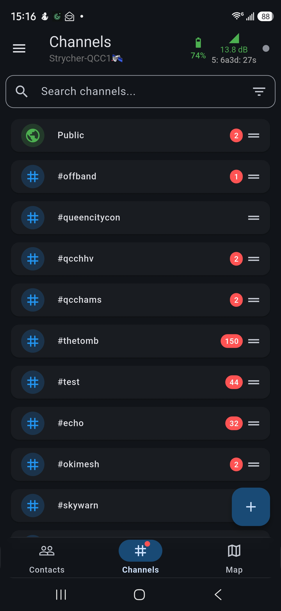
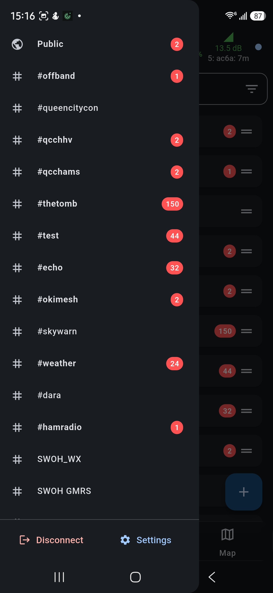

# Install the app and connect your radio

## Get the app

| Platform | Where |
|---|---|
| Android | [Google Play](https://play.google.com/store/apps/details?id=app.offband.meshcore), or the `.apk` on the [releases page](https://github.com/OffbandMesh/meshcore-client/releases) |
| Windows, macOS, Linux | The `offband-windows-x64.zip`, `offband-macos.zip` and `offband-linux-x64.tar.gz` downloads on the [releases page](https://github.com/OffbandMesh/meshcore-client/releases) |
| Web | [offband.app](https://offband.app) in Chrome or Edge |

The web app uses Web Bluetooth, which works only in Chromium-based browsers
(Chrome, Edge) and not in any browser on iPhone or iPad. TCP connections are not
available on the web.

## Connect

Your radio must run MeshCore **companion** firmware. A repeater or room-server
image can't be connected to directly; manage those from the app with a
[repeater login](repeaters.md).

- **Bluetooth:** scan from the app's first screen and pick your radio. The radio
  may ask for a pairing PIN. You can see or change your radio's PIN later under
  **Settings > Actions > BLE pairing PIN**.
- **USB:** plug the radio in and choose its serial port.
- **TCP:** enter the host and port of a radio that is reachable over your
  network. Not available on the web.

## Find your way around

Once connected, the app opens on three tabs:

| Tab | What it's for |
|---|---|
| **Contacts** | People, repeaters and other nodes your radio knows, and direct messages with them |
| **Channels** | Group conversations: Public, hashtag channels and private channels |
| **Map** | Nodes with known positions, path traces and line-of-sight checks |

The top of each tab shows your radio's name, battery level and the signal of the
last packet it heard. The menu button at the top left opens the side panel,
which holds your channel list, **Disconnect** and **Settings**.

