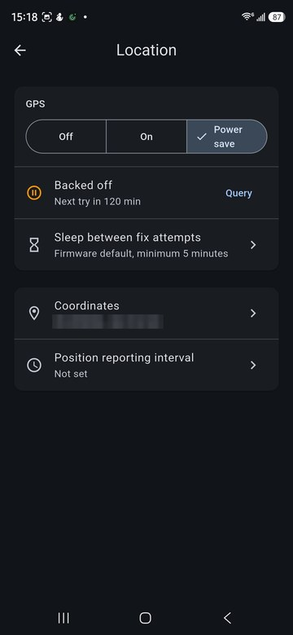
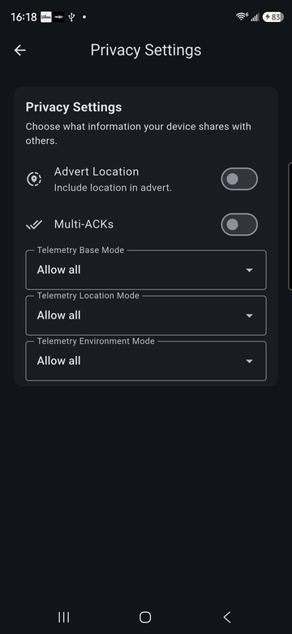
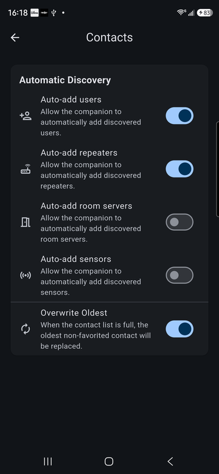
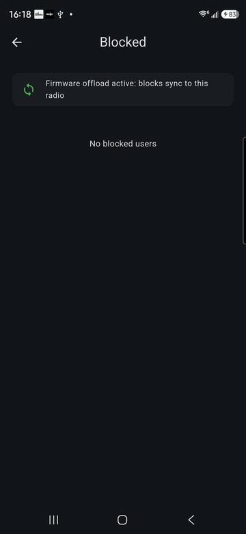

# Control location and privacy

## Your radio's location

**Settings > Location** controls the radio's GPS, on radios that have one:

- **Off**, **On**, or **Power save**, which takes a fix and then sleeps.
- **Sleep between fix attempts** sets how long power save waits.
- **Coordinates** shows and sets the position your radio reports.
- **Position reporting interval** sets how often the position is sent.

If the radio can't get a fix it backs off and shows when it will try again;
**Query** asks it now.

## What your radio shares

**Settings > Privacy Settings**:

- **Advert Location** includes your position in the advert other radios receive.
- **Multi-ACKs** sends extra delivery confirmations.
- **Telemetry Base, Location and Environment Mode** choose who may request each
  kind of telemetry from your radio.

Each contact can also be allowed or refused individually under that contact's
**Contact Settings**; see [Message contacts directly](contacts-and-messages.md#contact-menu).

## What contacts are added

**Settings > Contacts** chooses which kinds of node your radio adds
automatically when it hears them: users, repeaters, room servers and sensors.
**Overwrite Oldest** replaces the oldest contact that isn't a favorite when the
list is full.

## Blocking

Block a contact from its chat menu. Blocked contacts are listed under
**Settings > Blocked**. On radios that support it, the block list is also stored
on the radio.

