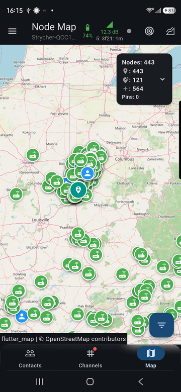
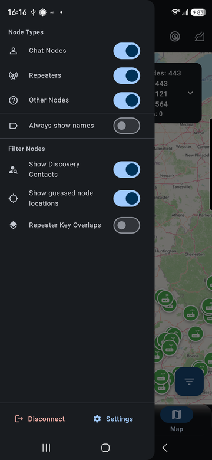
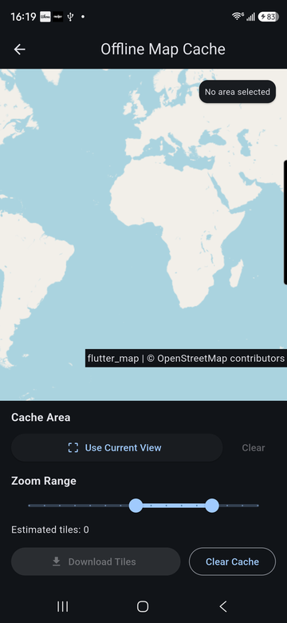
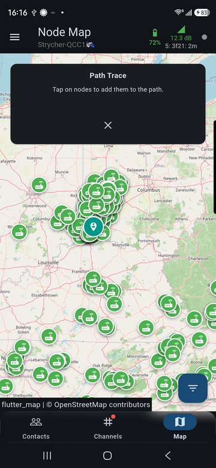
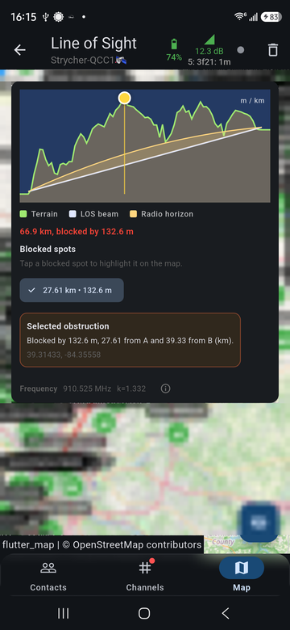

# Use the map, path traces and line of sight

## Node map

The **Map** tab shows every node with a known position. The panel at the top
right summarizes how many nodes are shown; tap its arrow for the breakdown.

The menu button at the top left chooses which nodes appear: chat nodes,
repeaters and other nodes, discovered contacts, guessed locations, and whether
names are always shown.

Map tiles come from OpenStreetMap. To use the map without a connection, save an
area first under **Settings > App Settings > Offline Map Cache**.

## Path trace

The path trace button at the top right starts a trace: tap nodes on the map, in
order, to build the route you want to trace. Tap the **X** to cancel.

## Line of sight

The line-of-sight button checks whether terrain blocks the radio path between
two points. Tap nodes, or long-press the map for a custom point, to set point A
and point B, then run the check.

The profile shows:

- **Terrain** along the path, from Open-Meteo elevation data.
- **LOS beam**, the straight line between the two antennas.
- **Radio horizon**, the curve the signal follows at your radio's frequency.

The result reads either "clear" with the minimum clearance, or "blocked" with
how far the terrain rises above the path. Tap a blocked spot to highlight it on
the map; the details give its distance from each end and its coordinates.

Distances and heights follow **Settings > App Settings > Units**.
