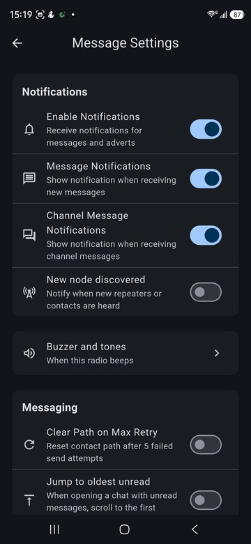
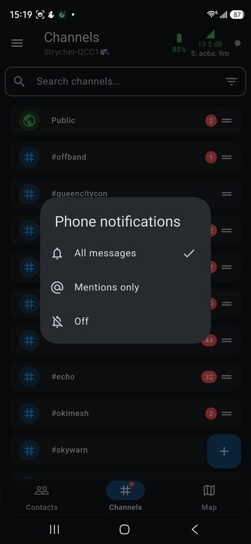
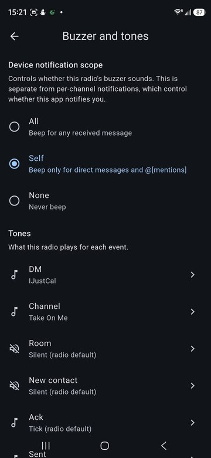
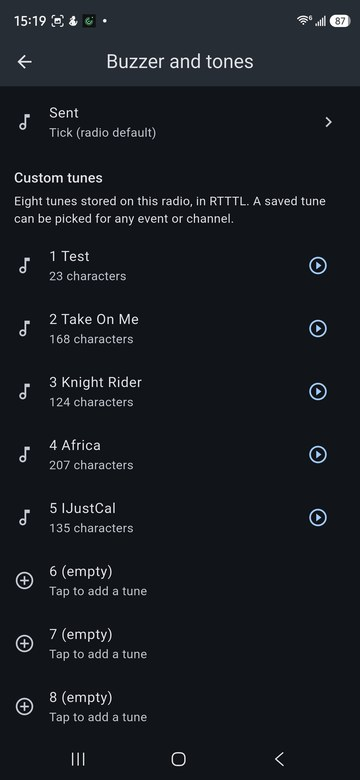
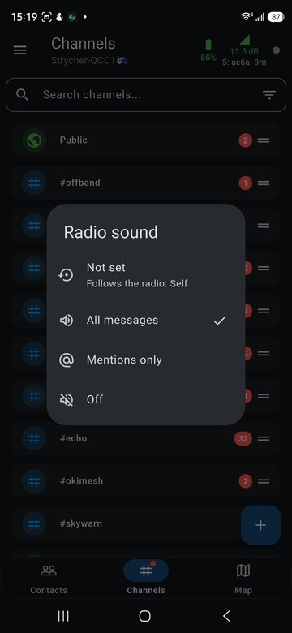
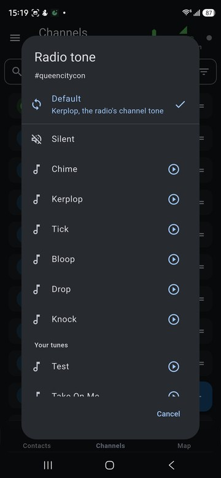

# Choose notifications, sounds and radio tones

There are two separate things that can alert you:

- **Phone notifications** come from the app on your phone or computer.
- **Radio sounds** come from the buzzer on the radio itself, on radios that have
  one and run firmware that supports it.

## App notifications

**Settings > Message Settings** turns app notifications on or off for direct
messages, channel messages and newly heard nodes.

Each channel also has its own setting. Long-press the channel and choose
**Phone notifications**: **All messages**, **Mentions only**, or **Off**.

## The radio's buzzer

**Settings > Message Settings > Buzzer and tones** sets when the radio beeps:

- **All:** for any received message.
- **Self:** only for direct messages and @mentions of you.
- **None:** never.

Below that, **Tones** picks what the radio plays for each event: a direct
message, a channel message, a room message, a new contact, an acknowledgement
and a sent message.

### Custom tunes

The radio stores eight custom tunes in RTTTL format. Tap an empty slot to add
one, and the play button to hear it on the radio. A saved tune can be picked for
any event or channel.

### Per channel

Long-press a channel to override the radio for that channel:

- **Radio sound:** **Not set** (follow the radio's setting), **All messages**,
  **Mentions only**, or **Off**.
- **Radio tone:** the tone this channel plays, from the built-in tones or your
  custom tunes.

