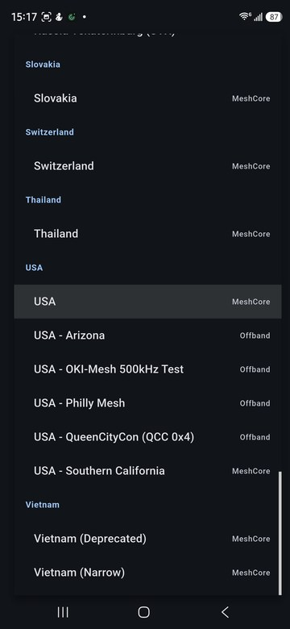
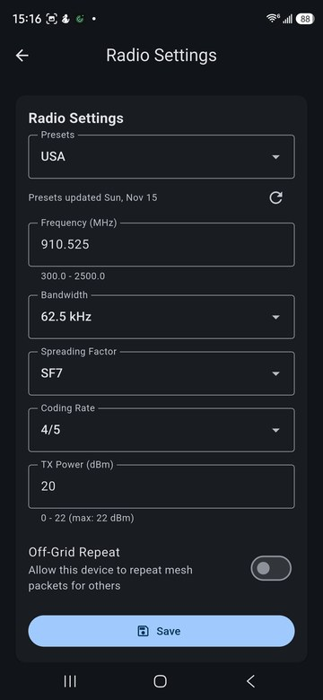
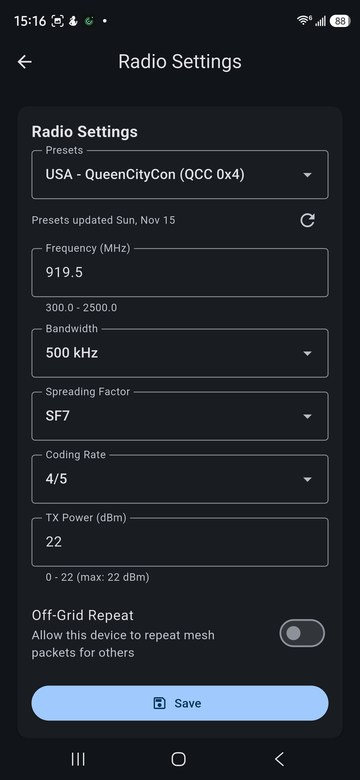
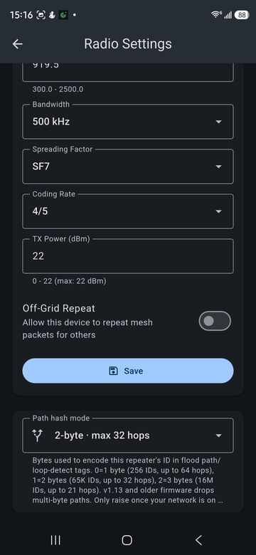
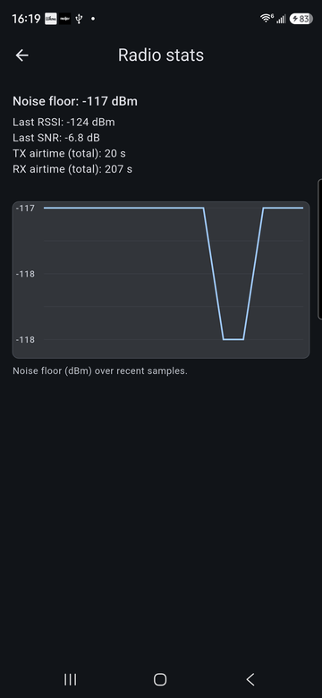
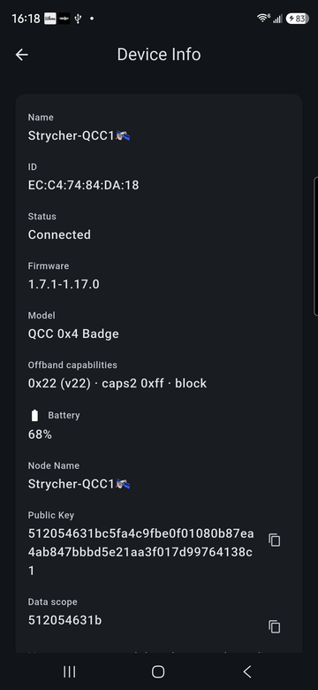

# Set your radio's frequency and presets

Radios only hear each other when they use the same frequency, bandwidth,
spreading factor and coding rate. Open **Settings > Radio Settings**.

## Pick a preset

The **Presets** list sets all four values at once. Presets are grouped by
country. Each is labeled **MeshCore**, from MeshCore's suggested regional
settings, or **Offband**, for presets Offband adds, such as event and local-mesh
settings. The date under the list shows when the presets were last updated; tap
the refresh button to fetch the latest.

In the United States, use **USA** unless your local mesh or an event tells you
otherwise.

## Set values by hand

You can also enter the frequency, bandwidth, spreading factor, coding rate and
transmit power yourself. The hint under each field shows the range your radio
accepts. Tap **Save** to write the settings to the radio.

- **Off-Grid Repeat** lets your companion radio repeat other people's packets.
- **Path hash mode** sets how many bytes identify each repeater in a route. More
  bytes mean fewer collisions between repeater IDs but fewer hops per route.
  Radios on firmware 1.13 or older drop multi-byte routes, so raise it only once
  your local network has updated.

## Check the radio

**Settings > Radio stats** shows the noise floor, the signal strength and SNR of
the last packet, and total transmit and receive airtime.

**Settings > Device Info** shows the radio's firmware version, model and
capabilities.

