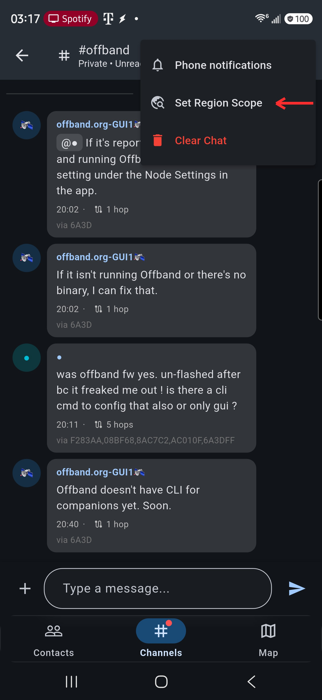
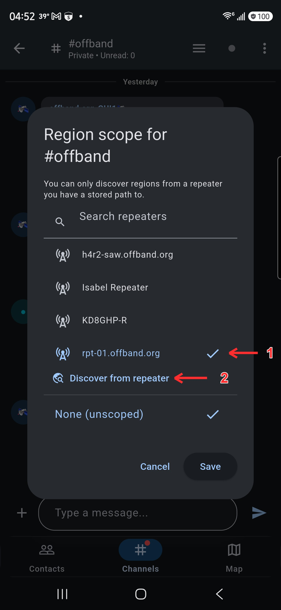
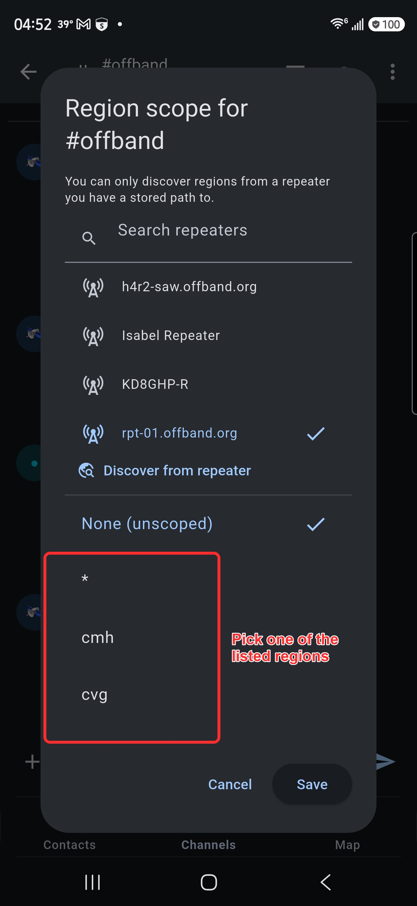
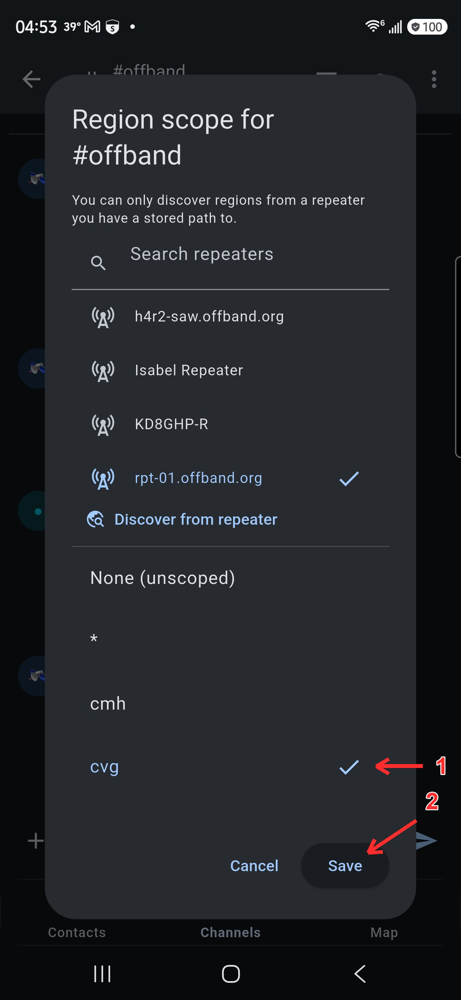
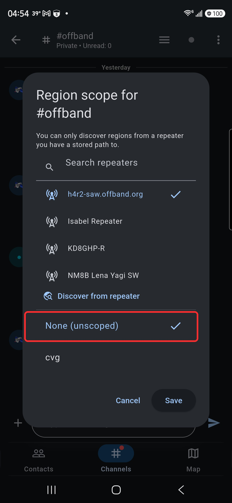

# Set a channel's region scope

A channel's **region scope** limits how far its messages travel. When a channel
is scoped to a region, only repeaters that allow that region pass its messages
on, so a local channel stays local instead of flooding the whole mesh.

Region scope needs repeaters near you that have regions configured, and your
radio needs a stored path to the repeater you ask. See
[the repeater has no stored path](#the-repeater-has-no-stored-path) below if the
one you want is greyed out.

## Set a scope

Open the channel, open the menu at the top right and choose **Set Region Scope**.

Pick a repeater you have a stored path to, then tap **Discover from repeater**.
You can only discover from a repeater your radio already has a route to.

The repeater answers with the regions it carries, and they appear in the list.
A name with `*` in it is a wildcard that matches a family of region names rather
than a single one.

Tap the region you want, then **Save**. The channel's outgoing messages now ride
that region's scope.

## Remove a scope

Open **Set Region Scope** again, choose **None (unscoped)** and **Save**. The
channel goes back to normal flooding.

## Troubleshooting

### The repeater has no stored path

If the repeater you want is greyed out as **No stored path**, your radio has not
learned a route to it yet. Get it to send an advert, or log into it once
([Contacts](contacts-and-messages.md) tab, tap the repeater, log in). Once your
radio stores the route the repeater becomes selectable. A stored path can also
go stale if the repeater or your radio moves, so a repeater that worked before
may need a fresh advert later.

### No response from the repeater

If discovery shows **No response ... the repeater may be out of range**, the
repeater did not answer in time. It may be out of range, or its stored path is
stale. Try again, or pick a closer repeater. Discovery makes one automatic retry
before it reports no response.

### The region list is empty

If a repeater answers but lists no regions, it has no regions configured, or its
firmware does not support them. Region scope only works with repeaters that have
regions set up.
