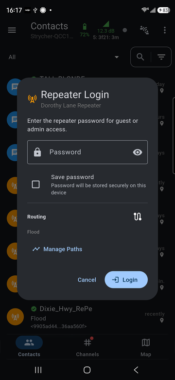

# Log in to and manage a repeater

Repeaters appear in your **Contacts** list with an antenna icon. Tap one to log
in.

Enter the repeater's guest or admin password. Tick **Save password** to keep it
on this device. **Manage Paths** chooses the route used to reach the repeater,
the same way as for a [direct message](contacts-and-messages.md#routing). Room
servers use the same login.

After logging in, the repeater's page opens:

| Page | Guest | Admin |
|---|---|---|
| **Status** | Yes | Yes |
| **Telemetry** | Yes | Yes |
| **Neighbors**: the repeaters it hears directly | Yes | Yes |
| **CLI**: the repeater's command line | | Yes |
| **Settings**: name, radio and other repeater settings | | Yes |

Repeater firmware and its commands are covered in the
[Offband firmware manual](https://docs.offband.org/firmware/).
