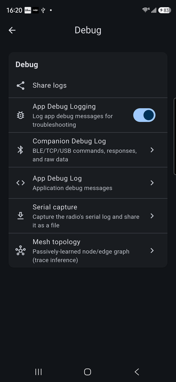
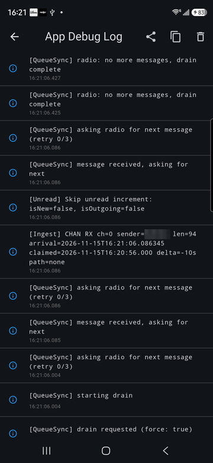
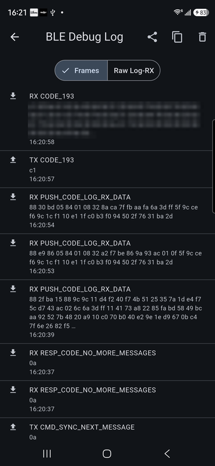

# Collect logs for a bug report

A log from around the time of a problem is often the fastest way to find its
cause. Open **Settings > Debug**.

1. Turn on **App Debug Logging**, if it isn't already, and reproduce the problem.
2. Tap **Share logs** and attach the file to your
   [bug report](https://github.com/OffbandMesh/meshcore-client/issues/new/choose).
3. In the report, say which radio, firmware version and app version you use
   (**Settings > Device Info** and **Settings > About**), what you did, what you
   expected and what happened.

## What's in the logs

- **App Debug Log:** what the app did, such as syncing messages, saving
  settings and deciding whether to notify you.
- **Companion Debug Log:** every frame sent to and received from your radio.
- **Serial capture:** records the radio's own serial log and shares it as a file.
- **Mesh topology:** the nodes and links the app has learned from routed packets.

## Before you share

Logs can contain contact names, public keys, message text and your radio's
location, sometimes in encoded form, such as a GPS reply shown as hex in the
companion log. Read through a log before posting it publicly, or send it
privately.
